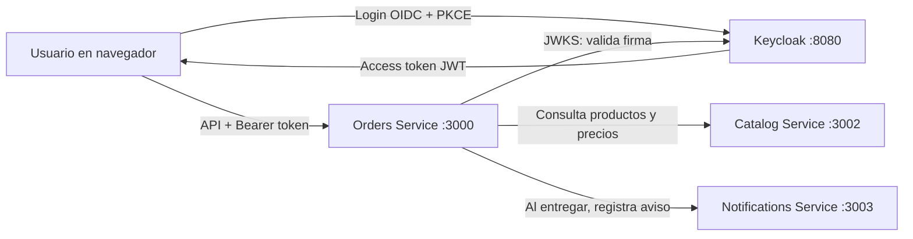
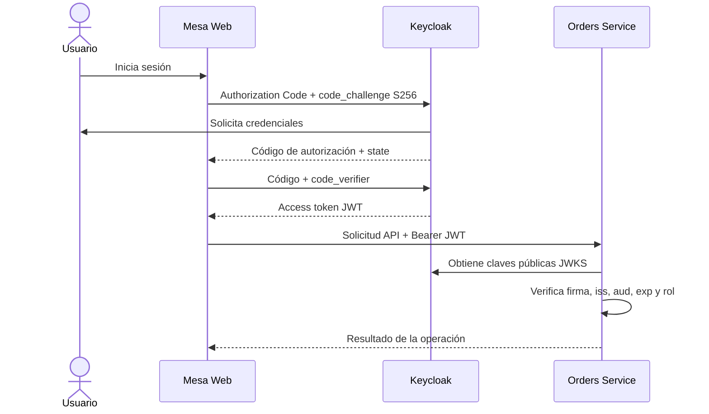
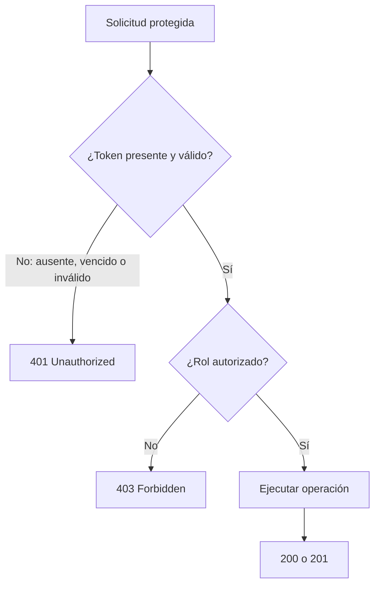
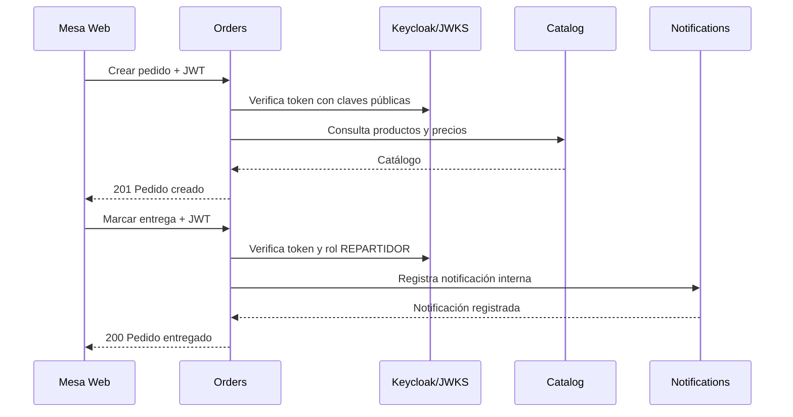

# 🚀 TP 2.2 DevOps — Seguridad: OAuth 2.0/OIDC, JWT y autorización entre servicios

Este repositorio contiene una aplicación práctica de pedidos y delivery para abordar el tema **Seguridad**. El sistema muestra cómo autenticar usuarios con OpenID Connect, emitir y validar access tokens JWT, y autorizar operaciones según los roles del usuario.

## 🎯 Consigna del trabajo práctico

| Tema | Categoría | Tema específico | Pregunta guía | Demo práctica sugerida |
| ---: | --- | --- | --- | --- |
| 6 | Seguridad | OAuth 2.0/OIDC, JWT y autorización entre servicios | ¿Cómo autenticar al usuario y autorizar cada recurso sin confiar solo en la interfaz? | Obtener y usar un token; comparar acceso autorizado, token vencido y usuario sin permiso. |

## 🧭 Qué demuestra esta aplicación

Mesa Delivery usa Keycloak como proveedor de identidad. El usuario inicia sesión mediante OIDC Authorization Code + PKCE; luego Orders Service valida el JWT y aplica permisos por rol. La autorización está en la API, aunque la interfaz también adapte las acciones que muestra.

| Prueba | Usuario/condición | Resultado esperado |
| --- | --- | ---: |
| Crear un pedido | `CLIENTE` con token válido | `201 Created` |
| Marcar un pedido como entregado | `CLIENTE` con token válido | `403 Forbidden` |
| Marcar un pedido como entregado | `REPARTIDOR` con token válido | `200 OK` |
| Consultar una ruta protegida | Token ausente, inválido o vencido | `401 Unauthorized` |


---

## Mesa Delivery: OAuth 2.0, OIDC y JWT

Aplicación local de pedidos y delivery para demostrar autenticación y autorización entre servicios. Keycloak administra la identidad, el inicio de sesión y los roles. La aplicación usa **OpenID Connect Authorization Code + PKCE (S256)**; Orders Service valida los access tokens JWT firmados por Keycloak antes de procesar operaciones protegidas.

## Arquitectura



| Componente | Puerto | Función |
| --- | ---: | --- |
| Keycloak | 8080 | Proveedor OAuth 2.0/OIDC, login, usuarios, roles y emisión de tokens |
| Orders Service | 3000 | Interfaz web, API de pedidos, validación de JWT y autorización por rol |
| Catalog Service | 3002 | Catálogo de productos y precios |
| Notifications Service | 3003 | Registra notificaciones internas al entregar pedidos |

Los cuatro componentes se definen en `docker-compose.yml`. Los servicios Node se construyen con el `Dockerfile` y se comunican dentro de una red Docker. El navegador accede a Mesa mediante `localhost:3000`.

## Estructura del proyecto

```text
auth-service/
├── .dockerignore                  # Archivos que se excluyen del contexto Docker
├── .editorconfig                  # Convenciones de indentación y codificación
├── docker-compose.yml             # Orquestación de los servicios
├── Dockerfile                     # Imagen compartida de los servicios Node
├── keycloak/
│   └── delivery-realm.json        # Realm, cliente OIDC, roles y usuarios de demo
├── modules/
│   ├── catalog-service.js         # API del catálogo de productos y precios
│   ├── notifications-service.js   # API interna de notificaciones de entrega
│   └── orders-service.js          # Interfaz web y API de pedidos; valida JWT y roles
├── package.json                   # Metadatos y comandos npm
├── public/
│   ├── branding.css               # Estilos del login y la marca
│   ├── index.html                 # Interfaz y flujo OIDC Authorization Code + PKCE
│   ├── mesa-logo.png              # Logo de Mesa Web
│   └── style.css                  # Estilos principales de la aplicación
└── README.md
```

## Requisitos

- Docker Desktop iniciado, con Docker Compose disponible.
- Puertos locales libres: `3000`, `3002`, `3003` y `8080`.

## Ejecutar en Windows (PowerShell)

1. Iniciá Docker Desktop y esperá a que esté listo.
2. Abrí PowerShell en la carpeta del repositorio y entrá a la aplicación:

   ```powershell
   cd .\auth-service
   ```

3. Construí e iniciá todos los contenedores:

   ```powershell
   docker compose up -d --build
   ```

   En el primer inicio se descargan las imágenes y Keycloak importa automáticamente el realm `delivery`.
4. Revisá el estado:

   ```powershell
   docker compose ps
   ```

   Esperá a que Keycloak quede `healthy`; el primer inicio puede tardar un poco.
5. Abrí [http://localhost:3000](http://localhost:3000) e iniciá sesión. Opcionalmente verificá el documento de descubrimiento OIDC:

   ```powershell
   Invoke-RestMethod http://localhost:8080/realms/delivery/.well-known/openid-configuration
   ```

6. Para ver los logs de los servicios:

   ```powershell
   docker compose logs -f
   ```

   `Ctrl+C` sale del seguimiento de logs, pero deja los contenedores encendidos.
7. Para detener y eliminar los contenedores y la red:

   ```powershell
   docker compose down
   ```

## Ejecutar en Bash

Desde la raíz del repositorio:

```bash
cd auth-service
docker compose up -d --build
docker compose ps
```

Abrí [http://localhost:3000](http://localhost:3000). Los comandos de operación son:

```bash
docker compose logs -f
docker compose down
```

## Cuentas de demostración

| Usuario | Contraseña | Rol |
| --- | --- | --- |
| `cliente` | `demo123` | `CLIENTE` |
| `repartidor` | `demo123` | `REPARTIDOR` |

Consola administrativa local: [http://localhost:8080/admin](http://localhost:8080/admin), usuario `admin`, contraseña `admin`. Estas cuentas son únicamente para desarrollo local.

## Cómo funciona la autenticación y autorización

1. La interfaz genera `state` y un verificador PKCE, y redirige al login de Keycloak con `code_challenge_method=S256`.
2. Keycloak autentica al usuario y devuelve un código de autorización. La interfaz comprueba `state` e intercambia el código por tokens usando el verificador PKCE.
3. La interfaz envía el **access token** a Orders en `Authorization: Bearer <token>` al llamar una ruta protegida.
4. Orders consulta metadatos OIDC y JWKS de Keycloak, y verifica algoritmo/firma RS256, `iss`, `aud` y `exp`.
5. Después de validar la identidad, Orders verifica el rol requerido por la operación.



El access token es una credencial para la API. El JWT está codificado, no cifrado: sus claims se pueden leer, por lo que no deben contener secretos. La interfaz usa el ID token para la sesión de identidad; Orders autoriza con el access token.

### Validación y permisos



| Caso de demostración | Resultado esperado |
| --- | ---: |
| Cliente crea pedido (`POST /api/pedidos`) | `201 Created` |
| Cliente intenta entregar (`PUT /api/pedidos/:id/entregado`) | `403 Forbidden` |
| Repartidor entrega pedido | `200 OK` |
| Falta el token o está vencido/inválido | `401 Unauthorized` |

**401** significa que no se presentó una credencial válida. **403** significa que el token identifica al usuario, pero su rol no permite esa operación. La interfaz puede ocultar acciones, pero la autorización real se aplica en la API.

### Comunicación entre servicios



## Configuración OIDC incluida

- Realm: `delivery`.
- Cliente público: `mesa-web`, Authorization Code habilitado y Direct Access Grants deshabilitado.
- PKCE: método `S256`.
- Redirect URI y Web Origin: `http://localhost:3000`.
- Audiencia esperada por Orders: `orders-api`.
- Issuer: `http://localhost:8080/realms/delivery`.
- Los access tokens de la demo vencen a los 60 segundos.
- Orders descubre las claves públicas en el endpoint JWKS del realm; no guarda la clave privada de Keycloak.


